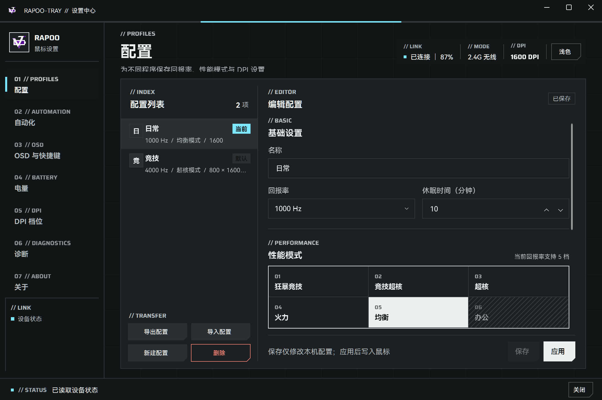
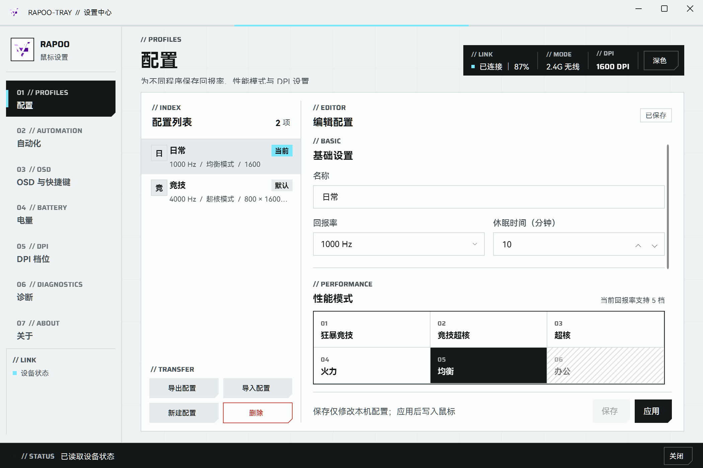
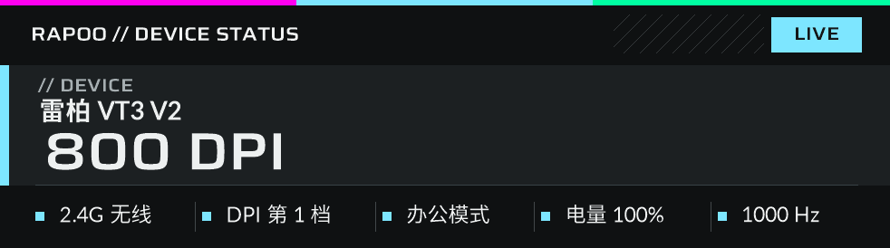
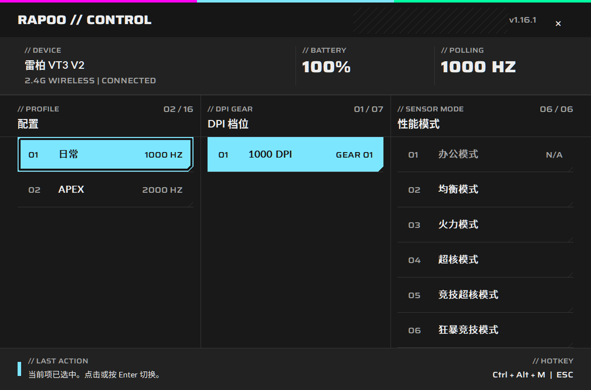
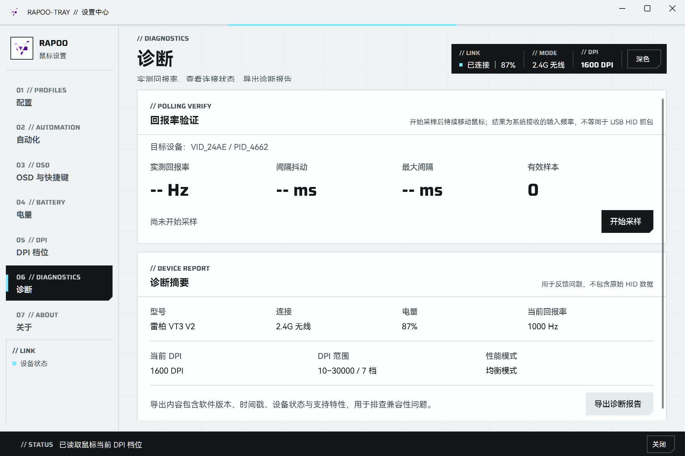
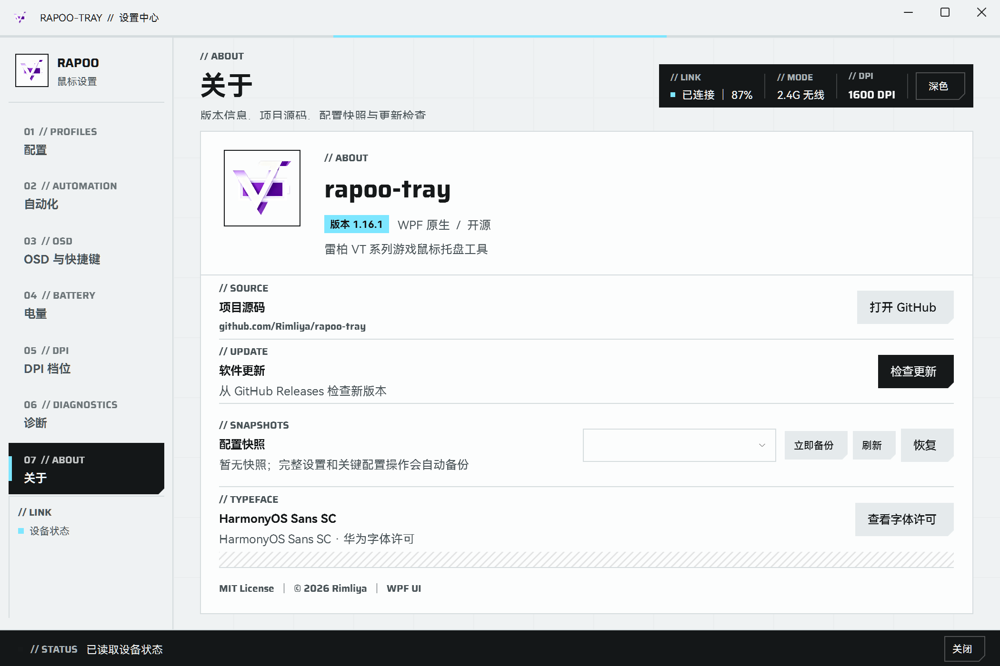

<div align="center">
  
  <h1>rapoo-tray</h1>
  <p><b>Rimliya fork</b> · 电量、DPI、回报率、配置切换和屏幕 OSD，都能从托盘里处理。</p>

  <p>
    <a href="https://github.com/Rimliya/rapoo-tray/releases/tag/v1.16.1"></a>
    
    
    
  </p>
</div>

---

> **v1.16.1 未包含代码签名。** 安装时 Windows SmartScreen 可能会拦截并提示“未知发布者”。Release 页面同时提供了 SHA256 校验文件，下载后可自行核对哈希值。

## 项目简介

`rapoo-tray` 是针对雷柏 VT 系列鼠标开发的 Windows 托盘工具。

插上鼠标后，托盘图标会直接显示当前电量。左键单击图标显示设备状态 OSD，右键菜单可以直接切换回报率、休眠时间和配置。如果需要微调 DPI 档位、绑定前台程序自动切换配置，或者查看历史电量曲线，可以打开设置中心。在游戏或全屏窗口下，按 `Ctrl + Alt + M` 即可呼出快速面板，无需切出当前窗口。

程序不接管系统鼠标驱动，也不包含宏录制和按键重映射功能，只负责读写雷柏硬件协议原本开放的参数：电量、DPI、回报率、休眠时间、性能模式与配置。

## 与上游分支的差异

本项目 fork 自 [Iris-0109/rapoo-tray](https://github.com/Iris-0109/rapoo-tray)。上游公开主线保留了轻量托盘工具的形态；截至 v1.16.1 发布提交，本分支相对上游累计 **48 个 commit，涉及 102 个文件、约 16,000 行新增代码**。

界面之外，设置中心、配置模型、DPI 编辑器、电量历史、OSD、诊断工具、应用内更新、安装程序和发布流水线都在这条分支里单独维护。版本号和上游不互通；这里对应的是 [Rimliya/rapoo-tray](https://github.com/Rimliya/rapoo-tray) 下的 `v1.x` Release。

| 场景 | 上游公开主线 | 本分支 (Rimliya fork) |
| --- | --- | --- |
| 日常操作 | 托盘看电量、调回报率 | 托盘菜单、快速面板和全局快捷键都能完成 |
| 配置管理 | 单组鼠标状态 | 多份配置，支持按前台程序自动切换 |
| DPI / 性能 | 基础档位和回报率 | 按型号限制能力、六档性能模式、自定义 DPI 档位 |
| 设置备份 | 无完整设置快照 | `.rapoo-snapshot` 备份整套设置，最多保留最近 20 份 |
| 问题排查 | 查看基础设备状态 | 采集 Raw Input 回报率、抖动、最大间隔，支持导出脱敏报告 |
| 版本更新 | 手动前往 Release 下载 | 应用内下载并校验 SHA256，失败后可直接重试或清缓存 |
| 分发形式 | 基础构建产物 | 提供安装版、便携版、TrafficMonitor 插件及 Actions 自动发布 |

提交 Issue 时请注明 **Rimliya fork、软件版本号、鼠标型号和 Windows 版本**。本分支特有的问题在上游仓库通常无法复现。

## v1.16.1 更新内容

这一版主要修复 1.16.0 遗留的细节问题：

- **回报率采样过滤**：Raw Input 采样现在会按当前雷柏设备的 VID/PID 过滤，接入多只鼠标时不会混入其他设备的输入数据。
- **完整设置快照**：快照现在包含配置、自动切换规则、OSD 样式、快捷键、电量提醒、开机自启和型号覆盖设置。恢复快照前会自动备份当前状态。
- **更新失败处理**：应用内下载失败后，可以直接在界面上打开 Release 页面、清理更新缓存、重新下载或重新执行安装，不用再去 `%LOCALAPPDATA%` 手动翻目录。
- **设置中心字体渲染**：中文正文恢复为 Regular 字重，重新调整了字号、对比度和 ClearType 参数，改善小字号下的发糊问题。
- **状态 OSD 布局调整**：设备型号与核心读数分层显示，连接方式、DPI 档位、性能模式、电量和回报率移至底部分栏，字段较多时也不会挤成一排。
- **快速面板标题修正**：修复了宽体英文字体与版本号同时显示时的文本截断问题。

## 技术选型：为什么用原生架构

托盘常驻进程、HID 通信和屏幕 OSD 全部基于 Win32 原生 API 实现。设置中心使用 WPF 编写，通过本机命名管道（Named Pipe）与托盘进程通信，没有为了画几个设置页面引入 WebView2 或 Chromium。

对于常驻后台的硬件工具，启动速度、输入延迟和内存占用比前端框架的开发便利性更重要。界面可以做成深色控制台风格，但没必要为此在后台常驻一个浏览器内核。

## 下载

- [安装版 `rapoo-tray-setup.exe`](https://github.com/Rimliya/rapoo-tray/releases/download/v1.16.1/rapoo-tray-setup.exe)
- [便携版 `rapoo-tray-portable.zip`](https://github.com/Rimliya/rapoo-tray/releases/download/v1.16.1/rapoo-tray-portable.zip)
- [TrafficMonitor 插件 `rapoo-plugin.dll`](https://github.com/Rimliya/rapoo-tray/releases/download/v1.16.1/rapoo-plugin.dll)
- [全部版本](https://github.com/Rimliya/rapoo-tray/releases)

### 运行环境

- Windows 10 / 11 x64
- .NET Framework 4.8（Windows 10 / 11 默认自带）
- 日常运行无需管理员权限
- 不需要额外安装 WebView2、Electron、Chromium 或雷柏鼠标驱动

### 数据存储与网络行为

- 配置、快捷键和主题设置：`HKCU\Software\rapoo-tray`
- 配置快照目录：`%APPDATA%\rapoo-tray\snapshots`
- 更新包缓存目录：`%LOCALAPPDATA%\rapoo-tray\updates`
- 进程通信：设置中心与托盘程序仅通过本机命名管道通信，不监听任何本地或远程网络端口。
- 网络请求：无遥测或使用统计。程序仅在检查 GitHub Release、读取 SHA256 校验文件和下载更新包时发起联网请求。
- 卸载残留说明：卸载程序不会删除用户手动保存的自定义快照。

## 已知限制

- **不支持多设备同时管理**：目前仅针对单只活动鼠标或单个接收器工作。
- **回报率测试并非硬件抓包**：诊断页统计的是 Windows Raw Input 消息到达应用层的时间间隔，不等同于 USB/HID 硬件总线抓包数据。
- **部分新型号需手动补充特征**：未收录的型号虽然可以通过通用模式运行，但具体硬件上限（如最高回报率、特定性能模式）仍需按型号逐个补充进代码表。
- **无代码签名**：可执行文件未签名，下载和安装时可能会触发 Windows SmartScreen 拦截，当前信誉积累有限。
- **无固件更新、宏录制与按键重映射功能**。
- **不支持跨分支配置迁移与自动回滚**：覆盖安装前建议先导出配置快照，并保留旧版本安装包。

## 界面预览

设置中心采用深色工业控制台风格，使用冷灰底色、冰蓝高亮色、直角边框与切角按钮。视觉设计的目标是减少无效装饰，把当前连接状态、生效配置和可操作项清楚地区分开。

<a href="docs/screenshots/settings-wpf-dark.png"></a>
<a href="docs/screenshots/settings-wpf-fluent.png"></a>

<a href="docs/screenshots/osd.png"></a>
<a href="docs/screenshots/quick-panel.png"></a>

<a href="docs/screenshots/settings-diagnostics.png"></a>
<a href="docs/screenshots/settings-about.png"></a>

---

## 交互方式

| 操作 | 结果 |
| --- | --- |
| `Ctrl + Alt + M` | 打开快速面板，切换配置、DPI 档位和性能模式；快捷键可在设置中心修改 |
| 左键单击托盘图标 | 显示当前设备状态 OSD |
| 左键双击托盘图标 | 轮换托盘电池图标样式 |
| 右键单击托盘图标 | 打开托盘菜单，切换配置、回报率、休眠时间和开机自启 |

## 托盘功能与硬件参数

- **托盘图标状态**：图标颜色随电量变化。电量低于 30% 显示红色，充电时显示绿色，鼠标休眠或离线时变为灰色。
- **右键快捷修改**：通过托盘右键菜单修改回报率、休眠时间和性能模式后，参数会直接写入鼠标硬件，无需打开设置中心。
- **回报率档位**：支持 125、250、500、1000、2000、4000 和 8000 Hz。实际可选档位取决于鼠标型号及当前连接方式（有线 / 2.4G）。
- **DPI 档位管理**：支持增删档位、调整顺序、独立设置 X/Y 轴 DPI，并可直接从托盘菜单切换生效档位。
- **按程序自动切换配置**：配置可绑定指定可执行文件。切入目标程序（如全屏游戏）时自动加载对应配置，切出后恢复默认配置。
- **开机自启**：自启项写入当前用户的注册表 `Run` 键下，不请求管理员权限（不弹 UAC），也不创建系统计划任务。

---

## 支持设备

以下型号已通过实机验证；未在列表中的雷柏二代机型通常可通过通用模式运行。

| 设备型号 | 连接模式 | VID | PID | 支持状态 |
| :--- | :--- | :--- | :--- | :---: |
| **雷柏 VT7 V2 标准版** | 2.4G 无线接收器 | `0x24AE` | `0x1460` | 开发者实测 |
| **雷柏 VT7 V2 标准版** | USB 有线直连 | `0x24AE` | `0x4660` | 开发者实测 |
| **雷柏 VT3S** | 2.4G 无线接收器 | `0x24AE` | `0x1406` / `0x1410` | 社区实测，数据来自 [@hsb689](https://github.com/hsb689) |
| **雷柏 VT3S** | USB 有线直连 | `0x24AE` | `0x4606` / `0x1411` | 社区实测，数据来自 [@hsb689](https://github.com/hsb689) |
| **雷柏 VT3 MAX** | 2.4G 无线接收器 | `0x24AE` | `0x1417` | 社区实测，数据来自 [@sAchNMN](https://github.com/sAchNMN) |
| **雷柏 VT3 V2 标准版** | 2.4G 无线接收器 | `0x24AE` | `0x1412` / `0x1462` | 社区实测，数据来自 [@lbyisme](https://github.com/lbyisme) |
| **雷柏 VT3 V2 标准版** | USB 有线直连 | `0x24AE` | `0x4612` / `0x4662` | 社区实测，数据来自 [@lbyisme](https://github.com/lbyisme) |
| **雷柏二代游戏鼠标 (未打标机型)** | 2.4G / USB 有线 | `0x24AE` | 通用自动匹配 | 通用模式，待补充 |

### 未收录机型与 PID 提交方法

采用 Nordic 54L15 主控 / PAW3950 传感器的雷柏二代游戏鼠标，底层 HID 报文结构基本一致。未收录的具体型号会回退到**通用模式**，电量读取、DPI 调节、回报率切换和休眠设置一般都能正常工作。

如果型号识别有误，请先插上鼠标，运行仓库根目录下的 `获取鼠标PID.bat`。该脚本会将当前硬件的 PID 及对应的代码片段复制到剪贴板。你也可以在 PowerShell 中直接执行以下命令查询：

```powershell
Get-PnpDevice -PresentOnly | Where-Object { $_.InstanceId -like "*24AE*" } | Select-Object FriendlyName, InstanceId
```

提交设备支持 Issue 时，请附上鼠标具体型号、连接方式（2.4G 接收器或有线）以及上述命令的输出结果。确认后的 PID 会补充到 `src/device_manager.cpp` 的 `VERIFIED_MODELS` 列表中。

---

## 配置与自动切换

1. 右键单击托盘图标，选择 **设置中心…**。
2. 在左侧列表选择已有配置，或点击 **新增配置**。在右侧可修改配置名称、回报率、DPI X/Y 数值、休眠时间，并可勾选是否设为默认配置。
3. 点击 **浏览…** 选择需要关联的可执行文件（例如 `r5apex_dx12.exe`）。无论游戏运行在窗口、无边框窗口还是独占全屏模式下，Windows 仍能正常报告前台窗口进程，自动切换规则同样生效。
4. 点击保存后，当目标程序处于前台时会自动应用该配置；切换到其他窗口时则自动恢复为 **默认配置**。
5. 在托盘右键菜单的 **快速切换配置** 中可以手动指定当前生效的配置；手动切换不会改变自动切换所依赖的默认回退配置。
6. “编辑配置”中的 **DPI 数值** 会随配置一并保存，也可以点击 **读取当前值** 获取鼠标当前的 X/Y DPI；点击旁边的 **打开 DPI 档位编辑器…** 可增删、排序和修改完整的硬件档位列表。
7. 在“高级设置”中可勾选 **满格射频**（不勾选则为智能调节），并可选择对应鼠标型号以查看粗略的续航时间估算。
8. 打开 DPI 编辑器时程序仅读取鼠标当前的硬件档位，只有点击“应用并切换”才会真正写入鼠标硬件。因此重启或更新本程序不会把鼠标 DPI 重置回出厂默认的 800。而在切换配置时，程序会将该档案保存的 DPI 数值写入当前激活的硬件档位。

> 配置、默认项和自动切换开关写在注册表 `HKCU\Software\rapoo-tray` 下，不需要管理员权限，也不会污染程序运行目录。

---

## TrafficMonitor 插件

Release 里附带 [TrafficMonitor](https://github.com/zhongyang219/TrafficMonitor) 插件 `rapoo-plugin.dll`。插件直接通过 HID 读取设备状态，加载后可在任务栏窗口或主悬浮窗里显示鼠标电量和当前 DPI。

### 显示项目
- **鼠标电量**（例如：`M: 85%`，充电状态显示为 `M: ⚡85%`）
- **鼠标 DPI**（例如：`DPI: 800`）
- **鼠标悬停提示**：显示鼠标型号、连接方式、当前电量百分比及当前 DPI 档位。

### 安装步骤
1. 从 [Releases](https://github.com/Rimliya/rapoo-tray/releases) 下载 `rapoo-plugin.dll`。
2. 将 `rapoo-plugin.dll` 复制到 TrafficMonitor 根目录下的 `plugins` 文件夹中。
3. 重启 TrafficMonitor（或在右键菜单中依次选择“更多功能” -> “插件管理” -> “重新加载插件”）。
4. 打开 TrafficMonitor 的“选项” -> “任务栏窗口设置”或“主窗口设置”，勾选“鼠标电量”和“鼠标DPI”。

---

## 安装与卸载

Release 页面提供三种分发文件：

- **便携版 `rapoo-tray-portable.zip`**：解压后请保持原有目录结构不变，直接双击 `rapoo-tray.exe` 即可运行。
- **安装包 `rapoo-tray-setup.exe`**：包含托盘主程序、WPF 设置中心及相关依赖文件。安装后会生成开始菜单或桌面快捷方式，可通过 Windows 控制面板或“设置 -> 应用”正常卸载。
- **TrafficMonitor 插件 `rapoo-plugin.dll`**：由 TrafficMonitor 加载，直接通过 HID 读取设备状态，不要求托盘程序常驻。

---

## 硬件通信协议

程序通过 Windows 原生 HID API 直接与鼠标的厂商自定义端点（Vendor-Defined Usage Page）通信。

> 关于回报率与性能模式的完整实测矩阵、协议控制码及界面截图对照，请参阅 [docs/rapoo-performance-modes.md](docs/rapoo-performance-modes.md)。

### 1. 被动状态接收端点 (UsagePage: `0xFF00`, Usage: `0x0002`)
通过中断传输（Interrupt Transfer）接收 Report ID 为 `0x07` 的 19 字节实时状态包：
- `Byte [0]`: `0x07` (Report ID)
- `Byte [1]`: 设备标识（2.4G 接收器固定为 `0x20`）
- `Byte [2]`: 当前 DPI 档位索引（从 0 开始计数）
- `Byte [3..4]`: X 轴 DPI 数值（16 位小端序整数）
- `Byte [5..6]`: Y 轴 DPI 数值（16 位小端序整数）
- `Byte [7]`: 活跃状态标志
- `Byte [8]`: 物理电量百分比（`0x00` ~ `0x64`，对应 0% ~ 100%）

### 2. 双向控制与心跳检测通道 (UsagePage: `0xFF00`, Usage: `0x000E` / `0x000F`)
通过 33 字节的 Command Report (`0x06`) 与 Feature Report (`0x08`) 完成寄存器读写及设备离线判定：
- **写入寄存器**：向 Usage `0x000E` 写入 `[0x06, 0xA5, 0xA5, 0x01, Addr, Bank, Value, ...]`。
- **读取寄存器与心跳检测**：向 Usage `0x000E` 发送读取指令后，在 Usage `0x000F` 上调用 `HidD_GetFeature` 读取 33 字节应答包。当鼠标进入休眠或关闭电源时，该通道会立即返回超时错误，程序据此将设备标记为离线状态。

---

## 从源码构建

构建环境要求：Windows 10 / 11、Visual Studio 2022 C++ 工具链、CMake 3.21+、Ninja、.NET SDK 8+。运行 `build.bat` 会同时编译 Win32 托盘程序与 WPF 设置中心；若本机未安装 MSVC，构建脚本可回退使用开发工作区 `.tools` 目录下的 Zig 工具链。

### 1. 编译可执行程序
```cmd
build.bat
```
输出产物：`bin\rapoo-tray.exe`、`bin\rapoo-tray-settings.exe` 及 WPF UI 相关依赖库。本地构建产物仅供开发测试，请勿直接作为正式 Release 发布包上传。

### 2. 编译安装程序
先执行上一步完成主程序编译，再运行：
```cmd
cd installer
build_installer.bat
```
输出产物：`dist\rapoo-tray-setup.exe`

### 3. 编译 TrafficMonitor 插件
```cmd
cd plugin
build_plugin.bat
```
输出产物：`bin\rapoo-plugin.dll`

### 4. 正式发布流程
1. 在本地运行 `build.bat` 完成功能验证，不要直接上传本地编译产物。
2. 提交代码并推送 `v*` 格式的 Git tag，触发 GitHub Actions 的 `release.yml` 工作流，由 CI 环境使用 MSVC、.NET 与 MinGW 完成正式构建。
3. 工作流中的 Release 步骤通过仓库自带的 `GITHUB_TOKEN`（需具备 `contents: write` 权限）自动创建 GitHub Release 并上传产物。
4. 本地推送代码使用本机或 CI 环境变量配置的凭据，严禁将任何 GitHub Token 硬编码进源码、构建脚本或发布产物中。

---

## 第三方组件

- [WPF UI 4.3.0](https://github.com/lepoco/wpfui)：提供 WPF 控件、主题资源与 Windows 窗口集成，采用 MIT License。详见 [WPF UI License](licenses/wpf-ui-LICENSE.md) 与 [Third-party notices](licenses/wpf-ui-THIRDPARTY.txt)。
- [Saira](https://github.com/Omnibus-Type/Saira)：设置中心使用的宽体拉丁字体，采用 SIL Open Font License 1.1。详见 [Saira License](licenses/saira-OFL.txt)。
- [HarmonyOS Sans SC](https://developer.harmonyos.com/cn/docs/design/des-guides/font-0000001157868583)：设置中心内置的中文正文字体，Copyright 2021 Huawei Device Co., Ltd.，依据 HarmonyOS Sans Fonts License Agreement 随软件分发。详见 [HarmonyOS Sans License](licenses/harmonyos-sans-LICENSE.txt)。
- .NET Framework 4.8：Windows 10 / 11 系统内置运行时，运行设置中心无需额外安装 .NET 运行时。

---

## 鸣谢

- **[@Nuitfanee](https://github.com/Nuitfanee)** ([ClickSync](https://github.com/Nuitfanee/ClickSync))：雷柏双向控制协议和寄存器地址映射的参考资料。
- **[@dts-dan](https://github.com/dts-dan)** ([logi-tray](https://github.com/dts-dan/logi-tray))：托盘电池图标的设计参考。
- **[@hsb689](https://github.com/hsb689)**：补充了雷柏 VT3S 系列的硬件 PID。
- **[@sAchNMN](https://github.com/sAchNMN)**：补充了雷柏 VT3 MAX 系列的硬件 PID。
- **[@lbyisme](https://github.com/lbyisme)**：补充了雷柏 VT3 V2 标准版的硬件 PID。

---

## 免责声明

1. 本项目为个人维护的开源项目，与雷柏科技无任何隶属或合作关系，亦非雷柏官方软件。
2. 文中提及的“雷柏”与“RAPOO”商标及对应产品名称，其所有权均归深圳市雷柏科技股份有限公司所有。
3. 本软件按 MIT License 条款以“原样”（AS IS）提供。使用涉及硬件寄存器写入的功能前，请先备份个人配置并自行评估潜在风险。

---

## 开发文档

- [开发路线与未完成项](docs/roadmap.md)
- [Windows 代码签名配置](docs/signing.md)

---

## 许可证

本项目基于 [MIT License](LICENSE) 开源。
