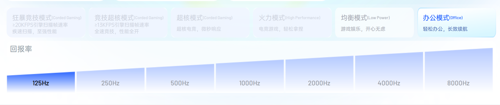
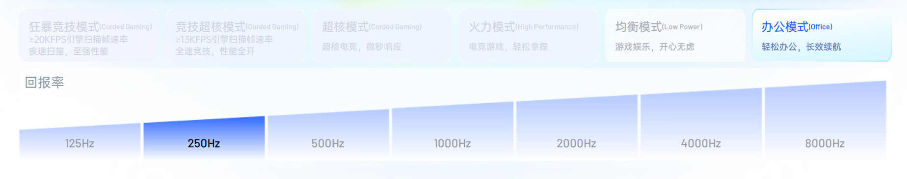
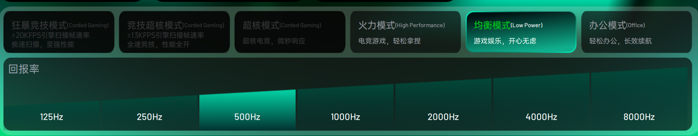
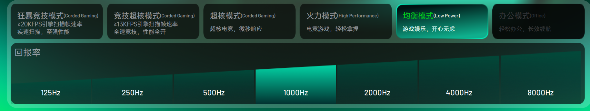
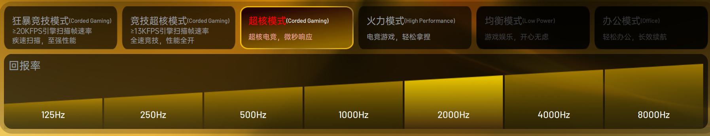
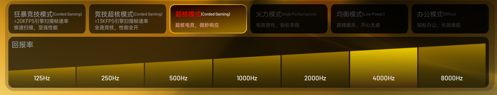
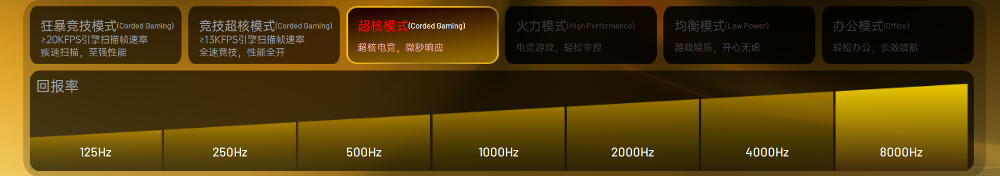

# Rapoo 回报率 × 性能模式对应表

> 依据：7 张 Rapoo App 实测截图，每档回报率各一张。  
> 记录日期：2026-10-27。  
> 适用范围：截图对应的 Rapoo 鼠标/固件能力；其他型号必须单独验证，不能默认通用。

本文只记录截图中能够直接确认的能力关系，并将 UI 模式名称与公开协议文档中的编码对应起来。截图本身不包含协议码，编码关系来自公开的 VT7 MAX 逆向文档，且与截图中的六档名称一一吻合。

## 1. 模式编码

| UI 顺序 | UI 名称 | 英文副标题 | 协议码 | 代码枚举建议 |
|---:|---|---|---:|---|
| 1 | 狂暴竞技模式 | Corded Gaming | `0x05` | `PERF_FURY_GAMING` |
| 2 | 竞技超核模式 | Corded Gaming | `0x04` | `PERF_GAMING_HYPER_CORE` |
| 3 | 超核模式 | Corded Gaming | `0x03` | `PERF_HYPER_CORE` |
| 4 | 火力模式 | High Performance | `0x02` | `PERF_FIRE` |
| 5 | 均衡模式 | Low Power | `0x01` | `PERF_BALANCED` |
| 6 | 办公模式 | Office | `0x00` | `PERF_OFFICE` |

注意：UI 顺序和协议码顺序相反。程序中必须以协议码为准，不能把卡片的显示索引直接当作寄存器值。

## 2. 回报率与可用模式矩阵

| 回报率 | 办公 `0x00` | 均衡 `0x01` | 火力 `0x02` | 超核 `0x03` | 竞技超核 `0x04` | 狂暴竞技 `0x05` |
|---:|:---:|:---:|:---:|:---:|:---:|:---:|
| 125 Hz | 可用 | 可用 | — | — | — | — |
| 250 Hz | 可用 | 可用 | — | — | — | — |
| 500 Hz | 可用 | 可用 | 可用 | — | — | — |
| 1000 Hz | — | 可用 | 可用 | 可用 | 可用 | 可用 |
| 2000 Hz | — | — | 可用 | 可用 | 可用 | 可用 |
| 4000 Hz | — | — | — | 可用 | 可用 | 可用 |
| 8000 Hz | — | — | — | 可用 | 可用 | 可用 |

紧凑表示：

```text
125 Hz  -> 0x00, 0x01
250 Hz  -> 0x00, 0x01
500 Hz  -> 0x00, 0x01, 0x02
1000 Hz -> 0x01, 0x02, 0x03, 0x04, 0x05
2000 Hz -> 0x02, 0x03, 0x04, 0x05
4000 Hz -> 0x03, 0x04, 0x05
8000 Hz -> 0x03, 0x04, 0x05
```

本地 UI 能力掩码如下。该掩码只用于界面置灰和合法性检查，不是要写入设备的协议值：

```cpp
// bit 0: office
// bit 1: balanced
// bit 2: fire
// bit 3: hyper core
// bit 4: gaming hyper core
// bit 5: fury gaming
constexpr uint8_t PERF_MODE_MASK_125  = 0x03;
constexpr uint8_t PERF_MODE_MASK_250  = 0x03;
constexpr uint8_t PERF_MODE_MASK_500  = 0x07;
constexpr uint8_t PERF_MODE_MASK_1000 = 0x3E;
constexpr uint8_t PERF_MODE_MASK_2000 = 0x3C;
constexpr uint8_t PERF_MODE_MASK_4000 = 0x38;
constexpr uint8_t PERF_MODE_MASK_8000 = 0x38;
```

## 3. 协议寄存器位置

VT7 MAX 协议中，性能模式寄存器相对配置档案基址的偏移为：

```text
profile_offset = 0x2DC + polling_rate_index
absolute_addr  = 0x600 + 0x400 * profile_index + profile_offset
```

Profile 0 的基址为 `0x600`。因此截图对应的是 24 位地址 `0x8DC–0x8E2`，拆分为 Bank/Addr 后为 `0x08:0xDC–0x08:0xE2`：

| 回报率 | 索引 | 档案内偏移 | 24 位地址 | Bank | Addr |
|---:|---:|---:|---:|---:|---:|
| 125 Hz | 0 | `0x2DC` | `0x8DC` | `0x08` | `0xDC` |
| 250 Hz | 1 | `0x2DD` | `0x8DD` | `0x08` | `0xDD` |
| 500 Hz | 2 | `0x2DE` | `0x8DE` | `0x08` | `0xDE` |
| 1000 Hz | 3 | `0x2DF` | `0x8DF` | `0x08` | `0xDF` |
| 2000 Hz | 4 | `0x2E0` | `0x8E0` | `0x08` | `0xE0` |
| 4000 Hz | 5 | `0x2E1` | `0x8E1` | `0x08` | `0xE1` |
| 8000 Hz | 6 | `0x2E2` | `0x8E2` | `0x08` | `0xE2` |

通用写法：

```cpp
constexpr BYTE ADDR_PERF_MODE_BASE = 0xDC;

// Profile 0: Bank 0x08, Addr 0xDC..0xE2
// Profile p: absolute = 0x600 + 0x400 * p + 0x2DC + pollingIndex
BYTE PerfModeBank(int profileIndex) {
    return static_cast<BYTE>(0x08 + 4 * profileIndex);
}

BYTE PerfModeAddress(int pollingIndex) {
    return static_cast<BYTE>(ADDR_PERF_MODE_BASE + pollingIndex);
}
```

如果以后支持多个配置档案，必须同时计算 Bank：

```text
addr24 = 0x600 + 0x400 * profileIndex + 0x2DC + pollingIndex
bank   = (addr24 >> 8) & 0xFF
addr   = addr24 & 0xFF
```

不能把截图中的 `0x08:0xDC` 当成所有档案共享的全局地址。

## 4. 实现约束

1. 性能模式属于“配置档案 × 回报率”组合状态，不是单一全局设置。
2. 切换回报率后，若原模式在新回报率下不可用，界面必须自动切换到合法模式，不能静默下发无效编码。
3. 写入前检查本地能力掩码；写入后读取对应寄存器验证实际值。Profile 0 为 Bank `0x08`、Addr `0xDC–0xE2`。
4. UI 可以固定显示六张模式卡片，但应依据矩阵置灰，而不是根据回报率猜测或隐藏。
5. 不建议直接复制 ClickSync 的四档模型：其 `low/hp/sport/oc` 只覆盖 `01/02/04/05`，会漏掉此设备实际存在的 `00` 办公和 `03` 超核。
6. 当前仓库已接入性能模式：设置页固定显示六张卡片，配置档案保存 `PerformanceMode`。设备层缓存 `0xDC` 起的 16 字节性能区域，并使用 4 字节块写入，保留相邻回报率槽位，避免逐槽读取造成切换卡顿。

## 5. 当前设置页接入

设置页中的配置详情已经加入性能模式卡片。卡片采用两行三列布局，顺序与 Rapoo App 一致，按当前回报率自动置灰不支持的组合；切换回报率时，C++ 层会把当前模式调整到最近的合法值。

托盘右键菜单也新增“性能模式”子菜单：显示当前模式、按当前回报率禁用不支持的档位，选择后后台写入并保存到当前配置。配置档案的“保存”只更新本机数据，“应用”才把回报率、性能模式、DPI 与休眠写入鼠标。


接入位置：

| 层 | 文件 | 作用 |
|---|---|---|
| 协议 | `src/rapoo_protocol.h/.cpp` | 模式编码、能力矩阵、寄存器地址 |
| 设备 | `src/device_manager.h/.cpp` | 读取、4 字节读改写、回读校验 |
| 配置 | `src/profile_manager.h/.cpp` | 保存并应用 `PerformanceMode` |
| 设置页后端 | `src/ui_bridge.cpp` | 本机命名管道、配置/DPI/设备命令与状态序列化 |
| 设置页 UI | `settings-ui/MainWindow.xaml` | WPF UI 六张模式卡片、回报率联动与 Fluent 2 布局 |

## 6. 截图对照

| 回报率 | 截图中可用模式 | 原始截图 |
|---:|---|---|
| 125 Hz | 办公、均衡 | [查看](screenshots/rapoo-performance-125hz.png) |
| 250 Hz | 办公、均衡 | [查看](screenshots/rapoo-performance-250hz.png) |
| 500 Hz | 办公、均衡、火力 | [查看](screenshots/rapoo-performance-500hz.png) |
| 1000 Hz | 均衡、火力、超核、竞技超核、狂暴竞技 | [查看](screenshots/rapoo-performance-1000hz.png) |
| 2000 Hz | 火力、超核、竞技超核、狂暴竞技 | [查看](screenshots/rapoo-performance-2000hz.png) |
| 4000 Hz | 超核、竞技超核、狂暴竞技 | [查看](screenshots/rapoo-performance-4000hz.png) |
| 8000 Hz | 超核、竞技超核、狂暴竞技 | [查看](screenshots/rapoo-performance-8000hz.png) |

<details>
<summary>展开全部截图</summary>

### 125 Hz



### 250 Hz



### 500 Hz



### 1000 Hz



### 2000 Hz



### 4000 Hz



### 8000 Hz



</details>

## 7. 证据等级

| 内容 | 证据 |
|---|---|
| 六档 UI 名称及中英文副标题 | 7 张 App 截图直接确认 |
| 每个回报率下的可用/置灰组合 | 7 张 App 截图直接确认 |
| 六档对应的协议码 `0x00–0x05` | 公开 VT7 MAX 协议文档，与截图名称一一吻合 |
| 档案内偏移 `0x2DC–0x2E2`；Profile 0 地址 `0x8DC–0x8E2` | 公开 VT7 MAX 协议文档 |
| 写入后设备实际接受 | 已在实机完成 `均衡 0x01 → 火力 0x02 → 均衡 0x01` 的读改写与回读验证 |

## 8. 参考资料

- [rapoo-vt7max-linux — PROTOCOL.md](https://github.com/matheus-wallace/rapoo-vt7max-linux/blob/main/docs/PROTOCOL.md)
- [ClickSync — protocol_api_rapoo.js](https://github.com/Nuitfanee/ClickSync/blob/main/src/protocols/protocol_api_rapoo.js)
- [mousectl — Rapoo VT3 PRO driver](https://github.com/D3m0nZOnFire/mousectl/blob/main/mousectl/drivers/rapoo_vt3pro.py)